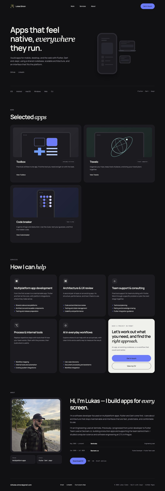

# Lukas Simon

**Software developer · Dart & Flutter**

A personal website and a home for independent apps. Written in Dart with Jaspr, rendered ahead of time, and ready for GitHub Pages.

Soft charcoal panels, blue accents, and locally hosted Manrope with italic serif details. A split hero, illustrated app cards, services, and an about section, built from reusable Dart components.



## Around the site

| Page | What lives there |
| --- | --- |
| **Home** | Introduction, selected apps, services, background, and CV download |
| **CV** | Professional profile and a downloadable A4 PDF |
| **Apps** | A compact directory linking to each app's own space |
| **Toolbox · Travelo · Code breaker** | Individual landing pages, privacy routes, and terms routes |

Service and app positioning copy remains provisional. The CV includes confirmed ongoing CTU talks. Toolbox and Code breaker are released; Travelo is in active development and unreleased. Legal pages clearly identify their placeholders; no store listings or legal claims have been invented. [TODO.md](TODO.md) tracks the remaining launch work.

## Start locally

You need **Dart 3.13+**. A current Flutter installation provides Dart too; this is a Jaspr website and does not need the Flutter engine, Node, or npm.

```text
dart pub get
dart run tool/site.dart dev
```

Open the local URL printed by Jaspr. The CLI is pinned as a project dependency, so no global Jaspr installation is required.

## A small, Dart-only workflow

| Command | Purpose |
| --- | --- |
| `dart run tool/site.dart dev` | Develop with hot reload |
| `dart run tool/site.dart check` | Check formatting, analyze, and test |
| `dart run tool/site.dart build` | Generate the PDF, build all pages, and verify local links |
| `dart run tool/site.dart preview` | Serve the last production build, including custom 404s |
| `dart run tool/site.dart cv` | Regenerate only the CV |
| `dart run tool/site.dart deploy` | Trigger deployment of the already-pushed remote `master` |

Run commands from the repository root. Format edits with `dart format lib tool test`.

To test a GitHub project URL locally:

```text
dart run tool/site.dart build --base=/personal-site/
dart run tool/site.dart preview
```

## Make it yours

Edit [`lib/content/profile.dart`](lib/content/profile.dart) for your introduction and public links, [`lib/content/apps.dart`](lib/content/apps.dart) for the app collection, and `lib/content/services.dart` and `lib/content/portfolio.dart` for the landing page copy. The website and PDF share profile/app content. Empty contact fields stay hidden; the footer indicates that contact details are pending.

Page composition lives in `lib/pages/`, reusable components in `lib/components/`, and the shared visual language in `lib/theme.dart`. All layouts and styles are authored in Dart. The PDF is generated with [`pdf`](https://pub.dev/packages/pdf).

See the [content guide](docs/content.md) for what still needs your details.

## Publish for free

Create a public GitHub repository, push to `master`, and choose **Settings → Pages → GitHub Actions**. The included workflow checks, builds, and publishes on subsequent pushes. It detects the correct root or repository base path automatically.

No paid backend, hosted font service, or purchased domain is required. The optional redeploy command uses an authenticated GitHub CLI and never stages, commits, or pushes your local work.

Follow the [deployment guide](docs/deployment.md) for first setup and troubleshooting.

## Built for humans and agents

[`AGENTS.md`](AGENTS.md) is the shared working agreement. `CLAUDE.md` and `GEMINI.md` link to it. Official, version-matched Jaspr skills are included in `.agents/skills/`, and VS Code tasks cover the everyday commands.

| Guide | Read it for |
| --- | --- |
| [Architecture](docs/architecture.md) | Components, routing, content, and design decisions |
| [Testing](docs/testing.md) | Automated checks, mobile review, and PDF verification |
| [Deployment](docs/deployment.md) | GitHub Pages setup and repeatable publishing |
| [Content](docs/content.md) | Profile edits, app information, legal content, and fonts |

## A few deliberate choices

- **Static first:** every route is a real HTML page, including nested legal URLs.
- **Dart throughout:** components, typed styles, scripts, build checks, and PDF generation.
- **Native browser behavior:** real links and downloads, semantic landmarks, keyboard focus, responsive layouts.
- **One repository:** personal site and app microsites share a simple foundation.
- **Local assets:** the bundled font includes its [SIL Open Font License](web/fonts/OFL.txt).

Project source is not yet assigned an open-source license. Add one before inviting reuse; third-party assets retain their own licenses.
